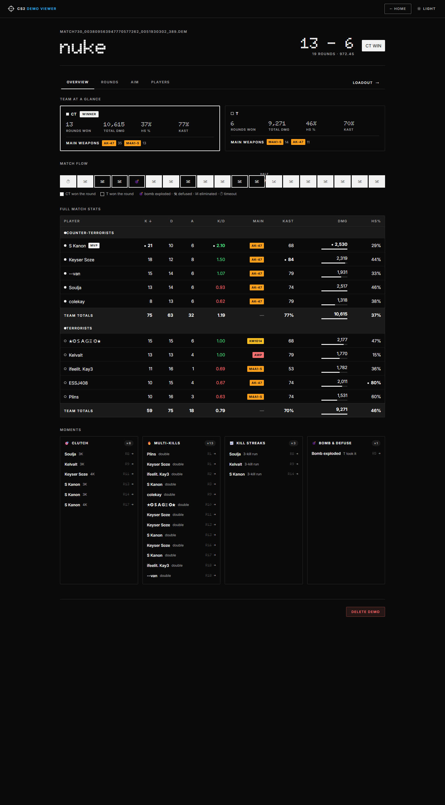
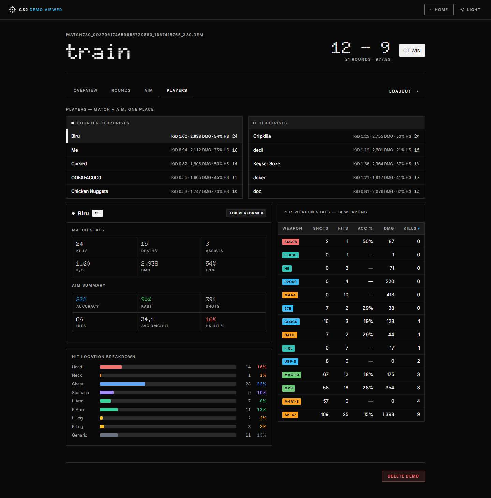
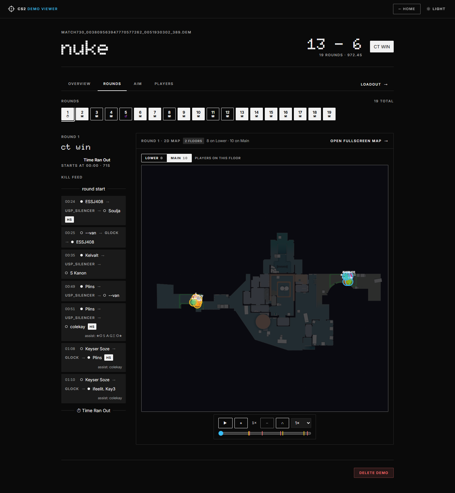
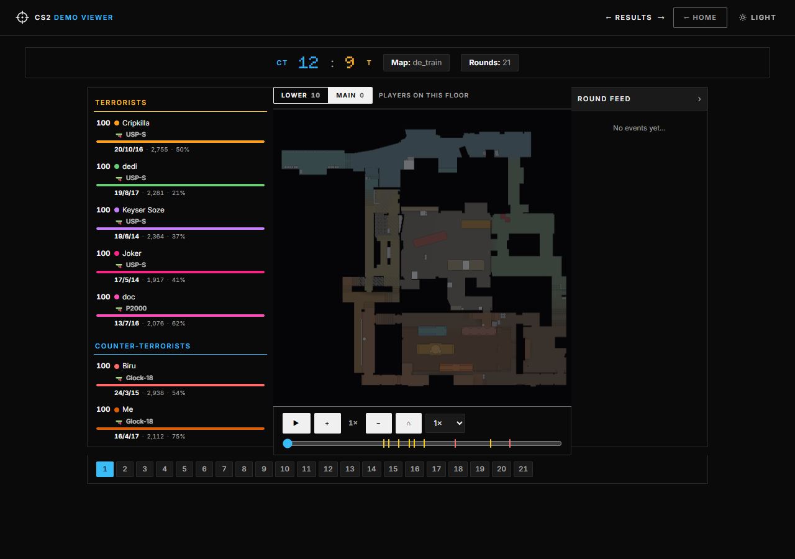
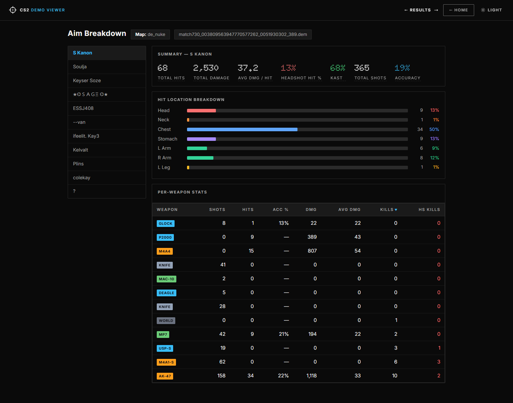
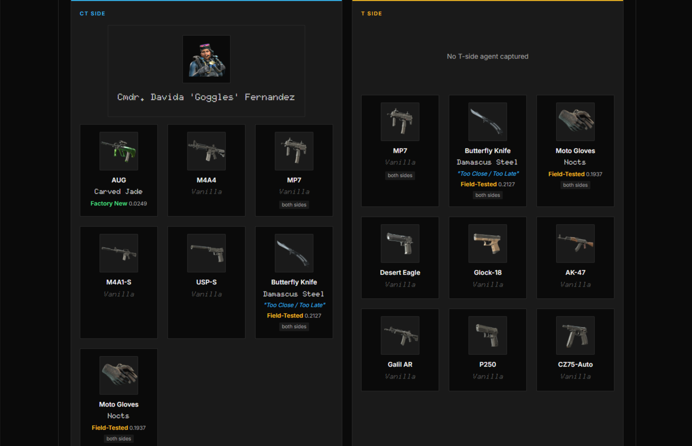
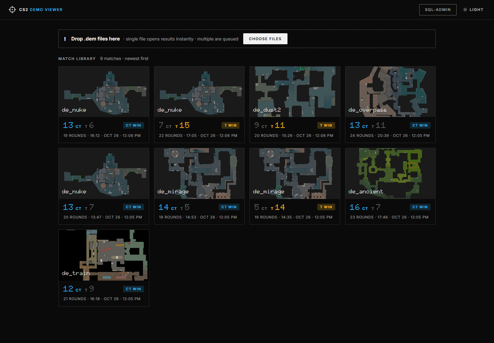

# CS2 Demo Viewer

A local web app for parsing and visualising Counter-Strike 2 `.dem` files.
Upload a demo and review the match: results page, multi-floor 2D replay, aim stats, and player loadouts — all in your browser, no account, no cloud.

The UI ships with **light and dark themes** (follows your system setting, toggle in the header). Screenshots below show the dark theme — click any thumbnail to open the full-size image.

---

## Features

### Match Results

[](screenshots/results-dark.png)

A full match review for each demo, organised as **four tabs** under the match header (sticky tab bar with a **Loadout →** CTA at its right end; ←/→ still steps through rounds on any tab):

- **Match header** — map, final score, winner, round count and duration
- **Overview tab** — four blocks that tell the match story: **Team at a glance** (CT vs T side by side: rounds won, total DMG, team HS %, KAST, team MVP, winner card marked), the **Match flow** strip (one segment per round — solid = CT, outlined = T, end-reason icons 💣🛠☠⏱, MR12 half break marked; click a segment to jump to that round), the upgraded **full-match stats table** (sortable; MVP badge on the best player, ADR (avg damage per round) and KAST columns, DMG bars scaled to the match max, ● best-of-match marker per column, green/red K/D, team totals rows), and **Moments** (auto-detected clutches, multi-kills, kill streaks and bomb moments, grouped by type with counts); every click selects its round and switches straight to the Rounds tab
- **Rounds tab** — one chip per round with the end reason (click, or use ←/→, to select), then the round on the 2D map as the tab's main content: the always-visible replay (floor tabs, scrubber with kill + bomb markers, static center-anchored zoom 1×–4×) fills the right column (~80%) while the round story (winner, end reason, start time and the full kill feed with weapons, HS / smoke / wall / no-scope flags and assists) reads as a compact rail on the left (~20%)
- **Aim tab** — the full aim breakdown inline: player switcher, summary stats (hits, damage, avg dmg/hit, HS-hit %, KAST, shots, accuracy), hit-location bars and the per-weapon table — no page hop needed
- **Players tab** — a CT/T team rail (sorted by kills, K/D · DMG · HS% at a glance) that doubles as navigation; the dossier shows a player's match stats, aim summary, hit-location breakdown and per-weapon table in one place, with a **TOP PERFORMER** badge on the match's best player (the default selection)

[](screenshots/results-players-dark.png)

- **Steam profile links** — every player name (stats table, kill feed, highlights, the Players dossier) links to that player's [Steam community profile](https://steamcommunity.com) in a new tab, resolved from the demo's SteamID64s (a small “steam ↗” pill floats above the name on hover — positioned so it can't push the row's content or overrun the card)
- **Header / tab-bar CTAs** — the header carries **Home only**; **Loadout** now sits at the right end of the sticky tab bar (the aim breakdown lives in the Aim tab; the `/aim/<id>` page is kept for share links); the 2D map is always visible on the Rounds tab — replay the round in place, or use its **Open fullscreen map** CTA to open the full map page deep-linked to that round

[](screenshots/results-rounds-dark.png)

- **2D map as the tab's main content** — the companion is always on (nothing to expand): its head carries the round label, the floor badge, the per-floor player distribution for the whole round and the **Open fullscreen map** CTA (opens the dedicated map page deep-linked to the current round), and its body is the full replay stage filling the column. The map is static, center-anchored — zoom (1×–4×) without the image drifting, and the page scrolls normally over it. The round story sits as a compact rail on the left; the old VIDEO SYNC card (demo_play command + jump grid) is gone — chips and ←/→ handle round selection.

### 2D Map Replay

[](screenshots/map-dark.png)

A dedicated page (`/map/<demoId>`) for stepping through any round on an accurate radar overlay — with live player details right alongside:

- **Player details panel** — per-frame HP, the **weapon held in the current frame** (e.g. M4A1-S, AK-47, knives, utility), full-match K/A/D · DMG · HS% and armor/helmet indicators per player; click a row to hide that player on the map. (Ammo is not exposed in CS2 demo data, so the panel shows weapon + HP + stats.)
- **Multi-floor maps** — maps with several floors (e.g. Nuke's Lower, Palais' 3 floors) get floor tabs with **live per-frame player counts**; switching a floor swaps the radar image and shows only the players on that floor at that moment (assigned by altitude). Single-floor maps are unchanged.
- **Live player positions** — colour-coded, name-labelled dots
- **Shot tracers** — lines anchored to each shooter for every recent shot
- **Round scrubber** — jump anywhere in the round; kill markers (yellow = headshot) and the bomb plant/defuse region are drawn on the timeline
- **Playback** — play / pause at 0.5×–4× speed
- **Free camera** — scroll-to-cursor zoom + drag-pan (0.25×–6×); the Results companion keeps the static, center-anchored zoom
- **Round feed** — timestamped buys, utility and kills beside the map
- **Round deep links** — `/map/<demoId>?round=N`, opened by the **Open fullscreen map** CTA on the Results Rounds tab (always deep-linked to the selected round)

### Aim Breakdown

[](screenshots/aim-breakdown-dark.png)

A dedicated page (`/aim/<demoId>`) to deep-dive into any player's shooting performance for the match:

- **Summary** — total hits, damage, avg damage/hit, headshot-hit %, KAST, shots, accuracy
- **Hit location breakdown** — Head / Neck / Chest / Stomach / Arms / Legs bars with counts
- **Per-weapon table** — shots · hits · ACC% · DMG · avg DMG · kills · HS kills for every weapon, with colour-coded weapon labels

> The same breakdown also lives **inline on the Results page** — the **Aim** tab (all players, switchable) and per-player inside the **Players** dossier. The standalone page remains for shareable `/aim/<demoId>` links.

### Loadout

[](screenshots/loadoutnextgen.png)

Browse every player's cosmetics as equipped during the match — **both sides, side by side**:

- **CT Side / T Side panels** — each player card shows a CT panel and a T panel, each with its agent + weapon grid, so the two loadouts are visible at once (panels stack on narrow screens). A weapon used on both sides appears in both panels with a “both sides” badge
- **Agent model** — the equipped agent per side
- **Weapon skins** — name, collection, wear tier and float value per slot
- **StatTrak™** badge where applicable

Loadouts are rebuilt from the demo's **purchase stream** — `item_pickup` events inside each round's buy window, attributed to the player's side at that moment from the team-switch timeline — instead of a single end-of-match snapshot, so a player's CT and T buys are stored separately. Paint data (skin · seed · wear · custom name) is joined from the demo's paint records. Demos parsed before this change can be rebuilt with `POST /api/demos/<id>/reparse`.

### Upload & Library

[](screenshots/upload-dark.png)

- **Upload strip** — drop `.dem` files on it (or pick via **Choose files**); up to **512 MB** per file. A single file opens its Results page instantly; multiple files are queued
- **Queue** — multiple files are queued; each shows upload progress and a "Parsing…" state while the server works
- **Match library grid** — one card per demo: map image, final score with winner badge (CT blue / T amber), rounds · duration · date. **Hover** a card for quick stats — top performer (kills · K/D), rounds, duration, and a **Results →** CTA — and a delete button; click the card to open Results (which links out to the 2D map, aim and loadout pages)

---

## Stack

| Layer | Tech |
|---|---|
| Demo parser | [demoparser2](https://github.com/Lee2th/demoparser2) via the `parser_foundation.py` wrapper |
| Map data & images | Bundled HLTV overview data + radar images in `maps/` (txt-first); [awpy](https://github.com/pnxenopoulos/awpy) only as a last-resort fallback |
| Numeric core | NumPy (vectorised tick extraction) |
| Backend API | Flask + SQLite |
| Frontend | React 19 + Vite |
| Map rendering | HTML5 Canvas |

The UI ships with a "paper & ink" theme in **light and dark modes** — it follows your system setting, with a toggle in the header.

---

## Prerequisites

| Tool | Minimum version | Download |
|------|----------------|---------|
| Python | 3.10+ | https://www.python.org/downloads/ |
| Node.js | 18+ (only to build the UI) | https://nodejs.org/ |
| npm | 9+ (comes with Node.js) | — |

> **Windows users:** during Python install, tick "Add Python to PATH".

---

## Installation

### 1. Clone the repository

```bash
git clone https://github.com/DerKysersoze/cs2demoviewer_noface.git
cd cs2demoviewer_noface
```

### 2. Install Python dependencies

```bash
pip install -r requirements.txt
```

This installs:
- **flask** — web server
- **demoparser2** — CS2 demo parser (pre-built wheels for Windows/macOS/Linux on PyPI — no compiler needed)
- **numpy** — vectorised tick extraction
- **pandas / polars** — data processing
- **awpy** — last-resort map bounds/images fallback
- **rich** — terminal output formatting

### 3. Install frontend dependencies (only if you want to build the UI)

```bash
cd frontend
npm install
cd ..
```

The pre-built UI already ships in `static_react/`, so you can skip this unless you modify the React source.

---

## Running the app

### Recommended: single server (UI + API)

```bash
python app.py
```

Flask serves the API **and** the built React UI from `static_react/` on one port.
Open **http://localhost:5000** — the upload page, results page, 2D map (`/map/<id>`), aim breakdown (`/aim/<id>`), loadout page, and the SQL admin page (`/admin`) all work from this single server.

> **How uploads work:** parsing runs as a **background job**. The upload itself returns in a couple of seconds, the queue item switches to a "Parsing…" state, and the demo appears in the library when the job completes (typically 30–60 s depending on demo size). You can upload more demos while one is parsing.

### Development mode (live-reload UI)

```bash
python start.py
```

Starts both the Flask backend (port 5000) and the Vite dev server (port 3000) together; API calls from the dev UI are proxied 3000 → 5000.
Open **http://localhost:3000** in your browser.

> Press `Ctrl+C` to stop both servers.

### Build the frontend yourself (optional)

```bash
cd frontend
npm run build
cd ..
```

Output goes to `static_react/`, which Flask serves.

---

## First run

1. Open the app in your browser.
2. Upload a `.dem` file (up to 512 MB).
3. The upload completes immediately and the item shows **"Parsing…"** while the server parses it in the background. When done, you land on the **Results** page — the 2D map, aim breakdown and loadout pages are one click away from there.

Map radar images for 27 maps (including the multi-floor sets for Nuke, Palais, Train, Vertigo and ar_baggage) ship in `maps/` — nothing to download for those. For a map without local radar data, the 2D replay offers a one-time "Download Map Images" fallback.

The SQLite database (`demos.db`), the stored-demo folder (`demos_store/`), and any downloaded images are created automatically — no manual database setup needed.

---

## Ports

| Service | Port | URL |
|---------|------|-----|
| Flask (UI + API) | 5000 | http://localhost:5000 |
| Vite dev server (dev only) | 3000 | http://localhost:3000 |

In development, API calls from the frontend are proxied from port 3000 → 5000 automatically.

---

## Project structure

```
cs2demoviewer_noface/
├── app.py                  # Flask backend: API, background parse jobs, SPA serving
├── parser_foundation.py    # demoparser2 wrapper (header/rounds/kills/damages/ticks/shots)
├── start.py                # Dev launcher (Flask + Vite)
├── requirements.txt        # Python dependencies
├── requirements-dev.txt    # Dev/test dependencies (pytest)
├── pytest.ini              # Test runner config
├── tests/                  # pytest suite (50 tests, ~25 s)
├── maps/                   # Bundled radar images + HLTV overview data (27 maps, multi-floor)
├── demos.db                # SQLite library (created on first use)
├── demos_store/            # Stored .dem files (created on first use)
├── images/                 # Fallback skin/agent/map images (created on demand)
├── screenshots/            # Feature screenshots (used in this README)
├── frontend/src/
│   ├── pages/
│   │   ├── Upload/         # Drop zone + queue + demo history
│   │   ├── Results/        # Match results page — 4 tabs: Overview · Rounds · Aim · Players (dossier)
│   │   ├── Map/            # Dedicated 2D replay page (player panel + stage + event feed)
│   │   ├── Aim/            # Dedicated aim page (shared AimBreakdown component)
│   │   ├── Loadout/        # Standalone loadout view
│   │   └── Admin/          # SQL admin page
│   └── components/
│       ├── MapReplayStage.jsx   # Shared 2D replay core (canvas, floors, playback)
│       ├── mapFloors.js         # Altitude → floor assignment
│       └── playerColors.js      # Player dot palette
├── static_react/           # Pre-built frontend (served by Flask)
└── struct_db/              # CS2 item data (agents, skins, stickers, etc.)
```

---

## Testing

The backend test suite (**50 tests, ~25 s**) runs with the Flask **test client** — no server and no port are started. It runs against the real `demos.db` + `demos_store/` and includes a **golden-blob guard**: fresh `extract_ticks` output must exactly match the ticks blob stored for the canonical de_nuke demo, so any parser regression fails the suite instead of silently changing replays.

```bash
pip install -r requirements-dev.txt
python -m pytest            # full suite
python -m pytest -k shots   # a subset, by keyword
```

> On Windows cp1252 consoles, prefix runs that print player names with `PYTHONIOENCODING=utf-8`.

---

## Troubleshooting

**`ModuleNotFoundError: No module named 'demoparser2'`**
Run `pip install -r requirements.txt` again. If using a virtual environment make sure it is activated. `demoparser2` is required for parsing.

**Map data missing / map renders incorrectly**
Map bounds and floors come from the bundled HLTV overview files in `maps/` first, with awpy as a fallback. If a map still can't render, use the **Download Map Images** button in the 2D replay overlay (requires an internet connection, one-time).

**Upload sits in "Parsing…" forever**
Parse jobs live in server memory: restarting the server drops in-flight jobs (just re-upload), and only the most recent 32 jobs are retained. For very large demos, allow up to a couple of minutes.

**`npm: command not found`**
Node.js is not installed or not on PATH. Install from https://nodejs.org/.

**Port already in use**
Another process is using port 5000 or 3000. Stop it or change the port in `app.py` and `frontend/vite.config.js`.
