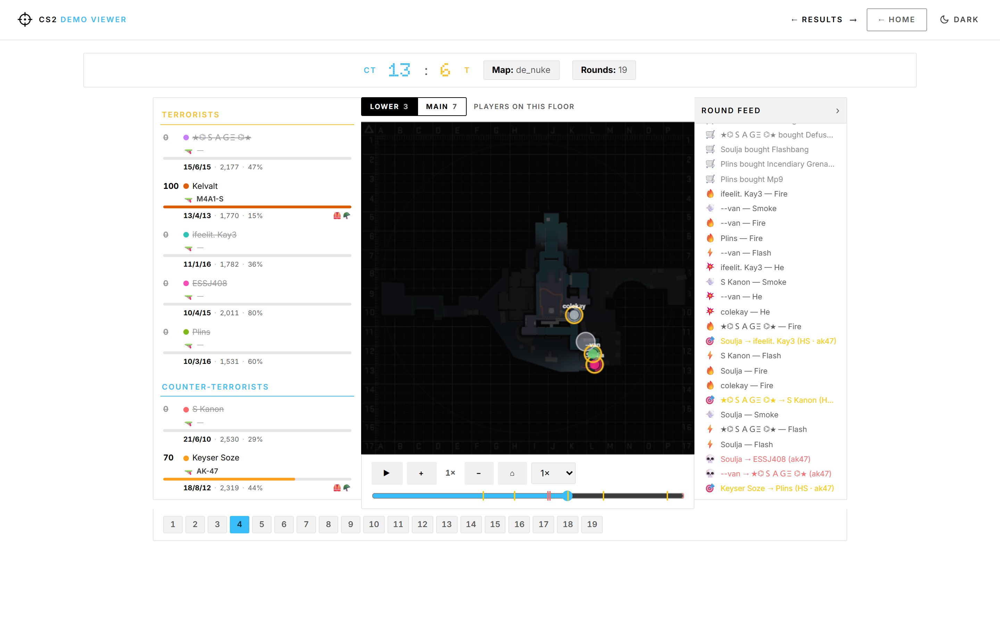
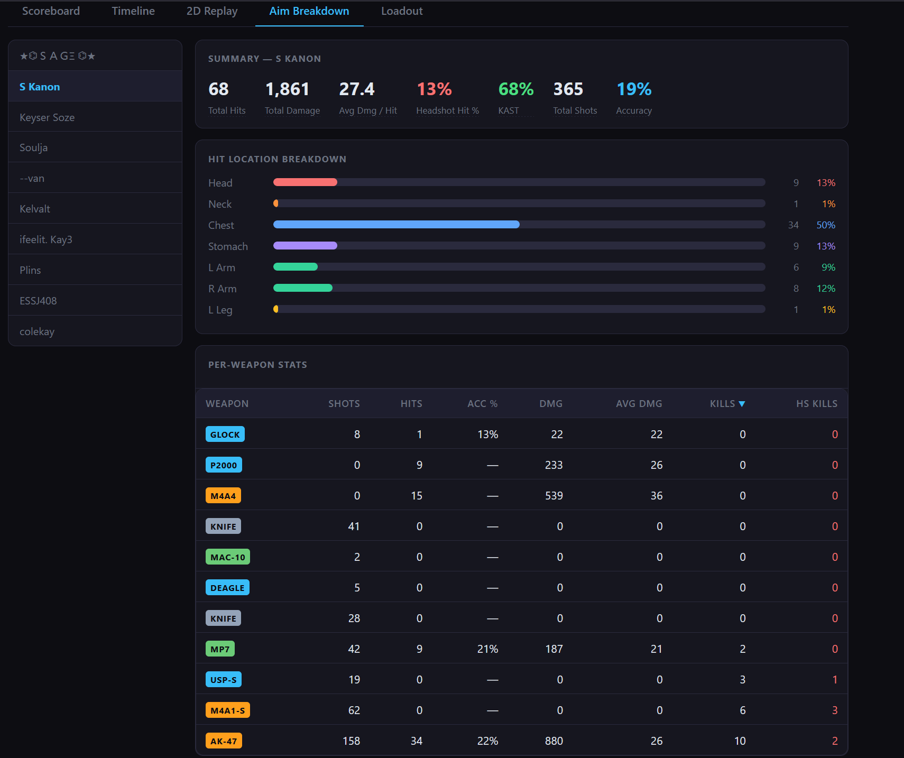
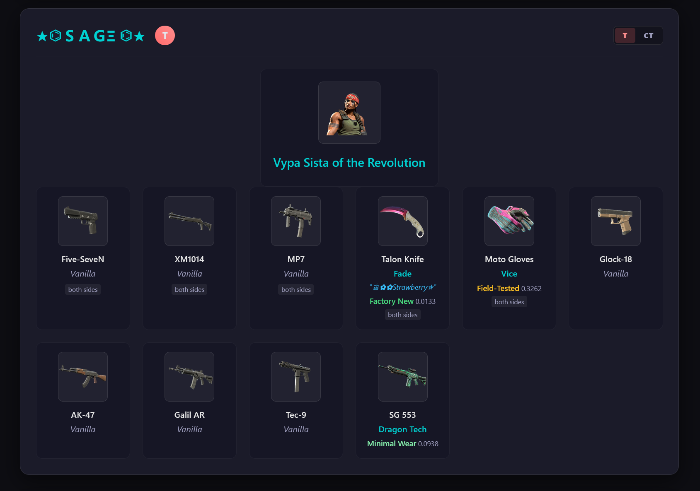

# CS2 Demo Viewer - a local analytic tool with the rich feature-set and expanding.

A local web app for parsing and visualising Counter-Strike 2 `.dem` files.  
Upload a demo, replay fights on an interactive minimap, dissect aim stats, and browse player loadouts — all in your browser.

---

## Features

### 2D Replay



Step through any round tick-by-tick on an accurate minimap overlay.

- **Live player positions** — colour-coded circles per player, labelled with name & HP bar
- **Shot tracers** — lines drawn between shooter and target for every shot fired
- **Kill feed** — scrollable event log on the right panel, timestamped per tick
- **Playback controls** — play / pause / step forward-backward, variable speed (1×–8×)
- **Round scrubber** — jump to any tick within the round; switch rounds from the bottom strip
- **Zoom & pan** — scroll-wheel zoom, drag to pan around the map


---

### Aim Breakdown



Deep-dive into any player's shooting performance for the match.

- **Summary row** — shots, hits, accuracy %, damage, HS%, total kills, assists
- **Hit location breakdown** — bar chart across Head / Neck / Chest / Stomach / Arms / Legs
- **Per-weapon table** — shots · hits · ACC% · DMG · AVG DMG · kills · HS kills for every weapon used, with colour-coded weapon labels by category

---

### Loadout



Browse every player's cosmetics as equipped during the match.

- **Agent model** — full render of the equipped agent skin
- **Weapon skins** — name, collection, wear tier, and float value for each slot
- **StatTrak™** badge where applicable
- **T / CT side toggle** — switch between the player's Terrorist and Counter-Terrorist loadouts

---

## Stack

| Layer | Tech |
|---|---|
| Demo parser | [awpy](https://github.com/pnxenopoulos/awpy) |
| Backend API | Flask + SQLite |
| Frontend | React 19 + Vite |
| Map rendering | HTML5 Canvas |

---

## Prerequisites

| Tool | Minimum version | Download |
|------|----------------|---------|
| Python | 3.10+ | https://www.python.org/downloads/ |
| Node.js | 18+ | https://nodejs.org/ |
| npm | 9+ (comes with Node.js) | — |

> **Windows users:** during Python install, tick "Add Python to PATH".

---

## Installation

### 1. Clone the repository

```bash
git clone https://github.com/DerKysersoze/cs2demoviewer_noface.git
cd cs2demoviewer_noface
```

### 2. Install Python dependencies

```bash
pip install -r requirements.txt
```

This installs:
- **flask** — web server
- **awpy** — CS2 demo parser (pulls in pandas and protobuf automatically)
- **pandas** — data processing
- **rich** — terminal output formatting

**Optional but recommended** — improves parsing performance and unlocks additional data fields (armor, weapon skins):

```bash
pip install polars demoparser2
```

> `demoparser2` is a compiled C extension. Pre-built wheels are available for Windows/macOS/Linux on PyPI — no compiler needed.

### 3. Install frontend dependencies

```bash
cd frontend
npm install
cd ..
```

---

## Running the app

Starts both the Flask backend (port 5000) and the Vite dev server (port 3000) together:

```bash
python start.py
```

Then open **http://localhost:3000** in your browser. This is the only URL needed to access the entire application and use it fully.

> Press `Ctrl+C` to stop both servers.

On first run, skin and agent images are downloaded automatically. This takes a moment but only happens once.

---

## First run

1. Open the app in your browser.
2. On the **Upload** page, click **Download Maps** — this fetches the map radar images from the awpy package (~50 MB, one-time download).
3. Upload a `.dem` file (up to 512 MB).
4. Parsing takes a few seconds to a minute depending on demo size.

The SQLite database (`demos.db`) and any generated images are created automatically — no manual database setup needed.

---

## Ports

| Service | Port | URL |
|---------|------|-----|
| Flask backend | 5000 | http://localhost:5000 |
| Vite dev server | 3000 | http://localhost:3000 |

API calls from the frontend are proxied from port 3000 → 5000 automatically.

---

## Project structure

```
cs2demoviewer_noface/
├── app.py              # Flask backend + demo parsing
├── start.py            # Launches both servers together
├── requirements.txt    # Python dependencies
├── screenshots/        # Feature screenshots (used in this README)
├── frontend/           # React/Vite source
│   ├── src/
│   └── package.json
├── static_react/       # Pre-built frontend (served by Flask)
└── struct_db/          # CS2 item data (agents, skins, stickers, etc.)
```

---

## Troubleshooting

**`ModuleNotFoundError: No module named 'awpy'`**  
Run `pip install -r requirements.txt` again. If using a virtual environment make sure it is activated.

**`npm: command not found`**  
Node.js is not installed or not on PATH. Install from https://nodejs.org/.

**Map images not showing**  
Use the "Download Maps" button on the Upload page. Requires an internet connection on first use.

**Port already in use**  
Another process is using port 5000 or 3000. Stop it or change the port in `app.py` and `frontend/vite.config.js`.

**`demoparser2` install fails**  
This is optional. The app works without it; some per-player cosmetic/armor fields will be absent.
