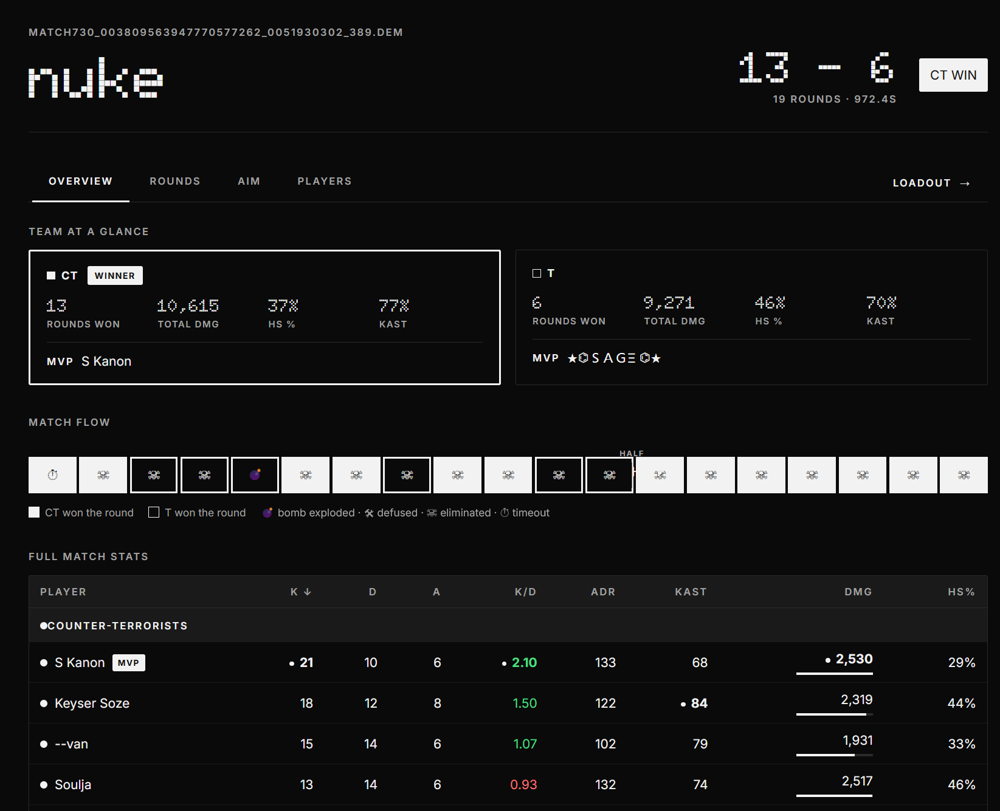

# CS2 Demo Viewer

**Parse Counter-Strike 2 demos into an interactive match review — round-by-round 2D replay, aim stats and full loadouts — entirely on your own machine.** No account, no cloud, nothing leaves your computer.

[](https://www.python.org/downloads/)
[](https://nodejs.org/)
[](CHANGELOG.md)
[](#privacy--local-first)

[**Quick start**](#quick-start) · [**Features**](#features) · [**Running the app**](#running-the-app)



*The Results page — Overview tab: team at a glance, match flow, full-match stats and moments.*

---

## Quick start

```bash
git clone https://github.com/DerKysersoze/cs2demoviewer_noface.git
cd cs2demoviewer_noface
pip install -r requirements.txt
python app.py
```

Open **http://localhost:5000**, drop a `.dem` file (up to **512 MB**) on the upload strip, and wait for the background parse (~30–60 s). You land on the **Results** page — the 2D map, aim breakdown and loadout are one click away.

> **Node.js** is only needed to rebuild the UI — the pre-built frontend ships in `static_react/`. On Windows, tick “Add Python to PATH” during the Python install.

---

## Screenshots

Dark theme below (the UI also ships a light theme — it follows your system setting, with a toggle in the header). Click any image for full size.

<table>
<tr>
<td width="33%"><a href="screenshots/results-rounds-dark.png"></a><br><sub>Results — Rounds · 2D map as the tab’s main content</sub></td>
<td width="33%"><a href="screenshots/results-players-dark.png"></a><br><sub>Results — Players · team rail + dossier</sub></td>
<td width="33%"><a href="screenshots/map-dark.png"></a><br><sub>Dedicated map replay · floors, scrubber, player panel</sub></td>
</tr>
<tr>
<td width="33%"><a href="screenshots/aim-breakdown-dark.png"></a><br><sub>Aim breakdown · hit locations + per weapon</sub></td>
<td width="33%"><a href="screenshots/loadoutnextgen.png"></a><br><sub>Loadout · CT &amp; T side by side</sub></td>
<td width="33%"><a href="screenshots/upload-dark.png"></a><br><sub>Upload strip + match library grid</sub></td>
</tr>
</table>

---

## Features

### Match results — four tabs, one match

**Match header** — map, final score with winner badge (CT blue / T amber), round count and duration.

**Overview** — four blocks that tell the match story, top to bottom:

- **Team at a glance** — CT vs T side by side: rounds won, total DMG, team HS %, KAST, team MVP (linked to Steam). The winner’s card is marked.
- **Match flow** — one segment per round: solid = CT win, outlined = T win, end-reason icons (💣 🛠 ☠ ⏱), the half break as a gap. Click a segment to jump straight to that round.
- **Full-match stats** — a sortable table grouped by team: MVP badge, ADR & KAST columns, DMG bars scaled to the match max, best-of-match dots, green/red K/D, team totals rows.
- **Moments** — auto-detected clutches, multi-kills, kill streaks and bomb moments, grouped by type with counts.
- **Jump links** — player names go to that player’s dossier on the Players tab; every other reference goes to its round.

**Rounds** — one chip per round with the end reason (click, or ←/→). The round on the **2D map is the tab’s main content** and always on: the replay (floor tabs, scrubber with kill + bomb markers, center-anchored zoom 1×–4×) fills ~80% while the round story — winner, end reason, start time and the full kill feed with weapons, HS / smoke / wall / no-scope flags and assists — reads as a compact rail on the left (~20%). **Open fullscreen map** takes you to the dedicated map page, deep-linked to that round.

**Aim** — the full breakdown inline: player switcher, summary (hits, DMG, avg dmg/hit, HS-hit %, KAST, shots, accuracy), hit-location bars and the per-weapon table. No page hop.

**Players** — a CT/T rail (sorted by kills, K/D · DMG · HS% at a glance) that doubles as navigation; the dossier holds a player’s match stats, aim summary, hit locations and per-weapon table in one place, with a **TOP PERFORMER** badge on the match’s best player (the default selection).

**Steam links** — everywhere outside the Overview tab, a player’s name opens their Steam community profile in a new tab (a “steam ↗” pill floats above the name on hover). **Share links** — `/results/<id>` · `/aim/<id>` · `/map/<id>?round=N`.

### 2D map replay

A dedicated page (`/map/<demoId>`) for stepping through any round on an accurate radar overlay:

- **Player panel** — per-frame HP, the weapon held in the current frame, full-match K/A/D · DMG · HS%, armor/helmet indicators; click a row to hide that player.
- **Follow mode** — click a dot or a row: the camera tracks that player and auto-switches floors; `Esc` (or clicking again) releases.
- **Multi-floor maps** — Nuke, Palais (3 floors), Train, Vertigo, ar_baggage: floor tabs with *live* per-frame player counts; only the players on that floor are shown.
- **Bomb** — the 💣 marker appears at the plant site while planted (only on that floor); the scrubber shows the plant → defuse/explode region.
- **Timeline** — red tick = kill, yellow = headshot; click a tick to jump there.
- **Live dots & tracers** — colour-coded, name-labelled dots; shot lines anchored to each shooter. Hover a dot for live name / HP / weapon.
- **Playback** 0.5×–4× · **Free camera** — scroll-to-cursor zoom (0.25×–6×) + drag-pan.
- **Round feed** — timestamped buys, utility and kills beside the map.
- **Help panel (?)** — bomb sites, controls and a legend for the map.

Radar images for 23 maps (multi-floor sets included) ship in `maps/`; a one-time **Download Map Images** fallback covers anything else.

### Aim breakdown

A standalone page (`/aim/<demoId>`) for shareable links — the same breakdown as the Aim tab: summary stats, hit-location bars (Head / Neck / Chest / Stomach / Arms / Legs) and a per-weapon table (shots · hits · ACC% · DMG · avg DMG · kills · HS kills) with colour-coded weapon labels.

### Loadout

Every player’s cosmetics as equipped during the match — **both sides, side by side**:

- **CT / T panels** per player — agent + weapon grid for each side; a weapon used on both sides gets a “both sides” badge. Panels stack on narrow screens.
- **Weapon skins** — name, collection, wear tier and float value per slot; **StatTrak™** badge where applicable.
- **Rebuilt from the buy stream** — `item_pickup` events inside each round’s buy window, attributed to the player’s side at that moment — not a single end-of-match snapshot. Paint data (skin · seed · wear · custom name) is joined from the demo’s paint records.
- Demos parsed before this change can be rebuilt with the reparse endpoint (`POST /api/demos/<id>/reparse`).

### Upload & library

- **Upload strip** — drop `.dem` files on it (or pick via **Choose files**), up to **512 MB** each. A single file opens its Results page as soon as it’s parsed; multiple files are queued.
- **Queue** — each file shows upload progress and a “Parsing…” state; you can upload more demos while one is parsing.
- **Match library grid** — one card per demo: map image, final score with winner badge, rounds · duration · date. **Hover** for quick stats (top performer, rounds, duration), a **Results →** CTA and delete.

---

## Privacy & local-first

- **100% local** — parsing, storage and the UI all run on your machine. No account, no cloud, no telemetry.
- **Your data stays yours** — `demos.db` (SQLite) and `demos_store/` (your `.dem` files) are created in the app folder; delete whatever you like from the library.
- **No connection details** — the demo header’s client/server names are deliberately never exposed: not in the API, not persisted, not logged.
- **Works offline** — everything runs without internet, except the optional one-time map-image download for maps without bundled radar data.

---

## Stack

| Layer | Tech |
|---|---|
| Demo parser | [demoparser2](https://github.com/Lee2th/demoparser2) via the `parser_foundation.py` wrapper |
| Map data & images | Bundled HLTV overview data + radar images in `maps/` (txt-first); [awpy](https://github.com/pnxenopoulos/awpy) only as a last-resort fallback |
| Numeric core | NumPy (vectorised tick extraction) |
| Backend API | Flask + SQLite |
| Frontend | React 19 + Vite |
| Map rendering | HTML5 Canvas |

The UI ships with a “paper & ink” theme in **light and dark modes** — it follows your system setting, with a toggle in the header.

---

## Getting started

### Prerequisites

| Tool | Minimum version | Download |
|------|----------------|---------|
| Python | 3.10+ | https://www.python.org/downloads/ |
| Node.js | 18+ (only to build the UI) | https://nodejs.org/ |
| npm | 9+ (comes with Node.js) | — |

### Install

```bash
git clone https://github.com/DerKysersoze/cs2demoviewer_noface.git
cd cs2demoviewer_noface
pip install -r requirements.txt

# only if you want to rebuild the UI yourself:
cd frontend && npm install && npm run build
```

This installs Flask (web server), `demoparser2` (CS2 demo parser — pre-built wheels, no compiler needed), NumPy (vectorised tick extraction), pandas / polars (data processing), awpy (last-resort map fallback) and rich (terminal output).

---

## Running the app

### Recommended — single server (UI + API)

```bash
python app.py
```

Flask serves the API **and** the built React UI from `static_react/` on one port → **http://localhost:5000**. The upload page, Results, 2D map (`/map/<id>`), aim (`/aim/<id>`), Loadout and the SQL admin page (`/admin`) all work from this single server.

**How uploads work:** parsing runs as a background job — the upload returns in a couple of seconds, the queue item switches to “Parsing…”, and the demo appears in the library when the job completes (typically 30–60 s). In-flight jobs live in server memory: restarting the server drops them (just re-upload), and the 32 most recent jobs are retained.

### Development — live-reload UI

```bash
python start.py
```

Starts the Flask backend (port 5000) and the Vite dev server (port 3000) together; API calls from the dev UI are proxied 3000 → 5000. Open **http://localhost:3000**. `Ctrl+C` stops both servers.

### Ports

| Service | Port | URL |
|---------|------|-----|
| Flask (UI + API) | 5000 | http://localhost:5000 |
| Vite dev server (dev only) | 3000 | http://localhost:3000 |

---

## Project structure

```
cs2demoviewer_noface/
├── app.py                  # Flask backend: API, background parse jobs, SPA serving
├── parser_foundation.py    # demoparser2 wrapper (header/rounds/kills/damages/ticks/shots)
├── start.py                # Dev launcher (Flask + Vite)
├── requirements.txt        # Python dependencies
├── requirements-dev.txt    # Dev/test dependencies (pytest)
├── pytest.ini              # Test runner config
├── tests/                  # pytest suite (52 tests, ~31 s)
├── maps/                   # Bundled radar images + HLTV overview data (23 maps, multi-floor)
├── demos.db                # SQLite library (created on first use)
├── demos_store/            # Stored .dem files (created on first use)
├── images/                 # Fallback skin/agent/map images (created on demand)
├── screenshots/            # Feature screenshots (used in this README)
├── frontend/src/
│   ├── pages/
│   │   ├── Upload/         # Upload strip + queue + match library grid
│   │   ├── Results/        # Match results — 4 tabs: Overview · Rounds · Aim · Players
│   │   │   ├── TeamCompare.jsx    # Overview — team at a glance
│   │   │   ├── FlowStrip.jsx      # Overview — match flow strip
│   │   │   ├── MatchStats.jsx     # Overview — full-match stats table
│   │   │   ├── Highlights.jsx     # Overview — Moments
│   │   │   ├── deriveOverview.js  # Pure aggregates for the Overview tab
│   │   │   └── PlayerDossier.jsx  # Players tab — per-player dossier
│   │   ├── Map/            # Dedicated 2D replay page (panel + stage + feed + help)
│   │   ├── Aim/            # Dedicated aim page (shared AimBreakdown)
│   │   ├── Loadout/        # Standalone loadout view
│   │   └── Admin/          # SQL admin page
│   ├── components/
│   │   ├── MapReplayStage.jsx   # Shared 2D replay core (canvas, floors, playback, bomb)
│   │   ├── mapFloors.js         # Altitude → floor assignment
│   │   └── playerColors.js      # Player dot palette
│   └── data/
│       └── mapSites.js          # Static bomb-site table for the help panel
├── static_react/           # Pre-built frontend (served by Flask)
└── struct_db/              # CS2 item data (agents, skins, stickers, etc.)
```

---

## Testing

The backend suite (**52 tests, ~31 s**) runs with the Flask **test client** — no server and no port are started. It runs against the real `demos.db` + `demos_store/` and includes a **golden-blob guard**: fresh `extract_ticks` output must exactly match the ticks blob stored for the canonical de_nuke demo, so any parser regression fails the suite instead of silently changing replays.

```bash
pip install -r requirements-dev.txt
python -m pytest            # full suite
python -m pytest -k shots   # a subset, by keyword
```

> On Windows cp1252 consoles, prefix runs that print player names with `PYTHONIOENCODING=utf-8`.

---

## Troubleshooting

**`ModuleNotFoundError: No module named 'demoparser2'`**
Run `pip install -r requirements.txt` again (activate your venv first, if you use one). `demoparser2` is required for parsing.

**Map data missing / map renders incorrectly**
Map bounds and floors come from the bundled HLTV files in `maps/` first, with awpy as a fallback. If a map still can’t render, use the **Download Map Images** button in the 2D replay (one-time, needs internet).

**Upload sits in “Parsing…” forever**
In-flight jobs live in server memory — restarting the server drops them (just re-upload). Only the 32 most recent jobs are retained; for very large demos allow up to a couple of minutes.

**`npm: command not found`**
Node.js isn’t installed or isn’t on PATH — install from https://nodejs.org/.

**Port already in use**
Another process holds 5000 or 3000 — stop it, or change the port in `app.py` and `frontend/vite.config.js`.

---

## License

No license is granted for this repository — all rights reserved.
